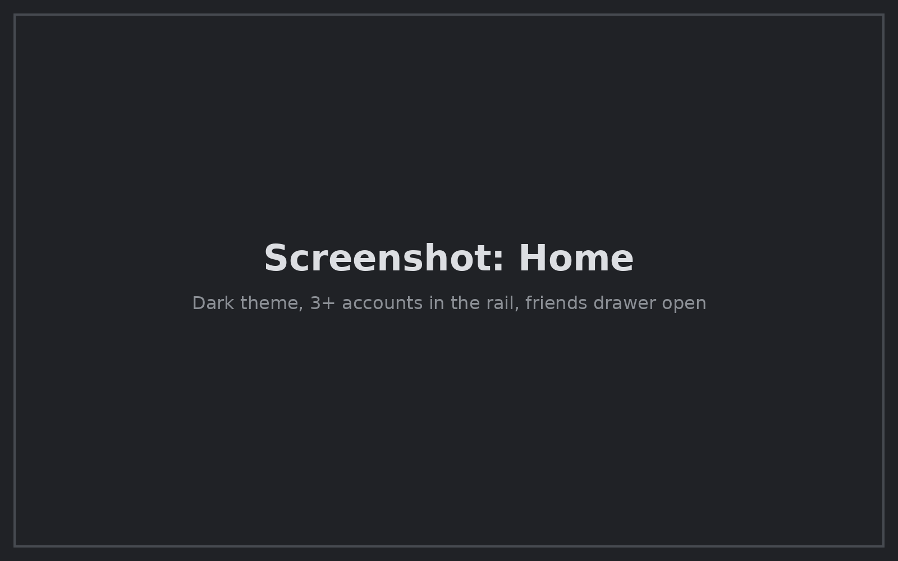
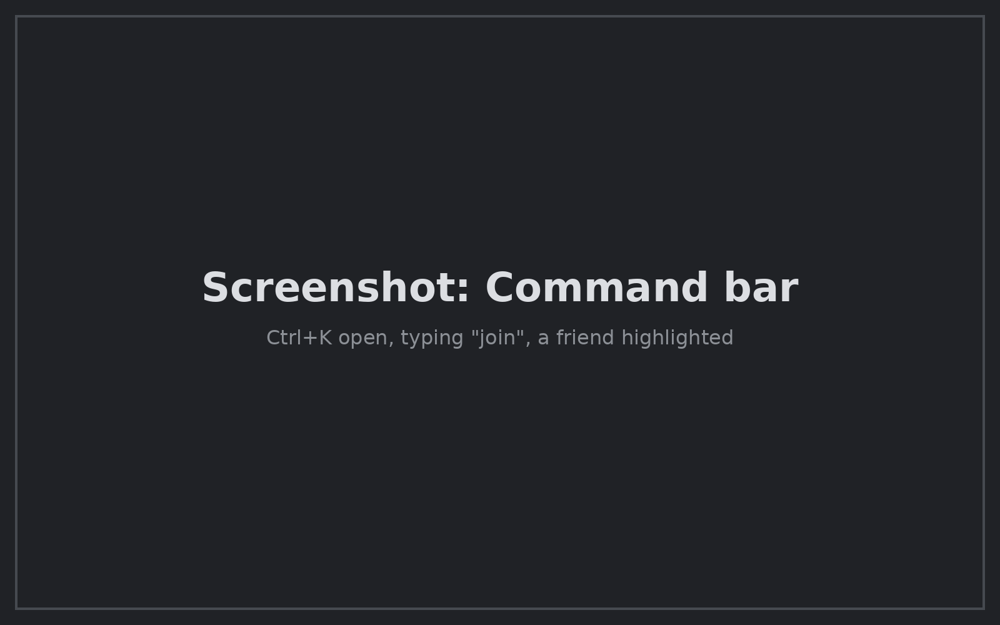
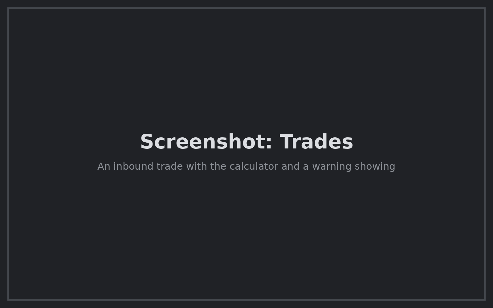
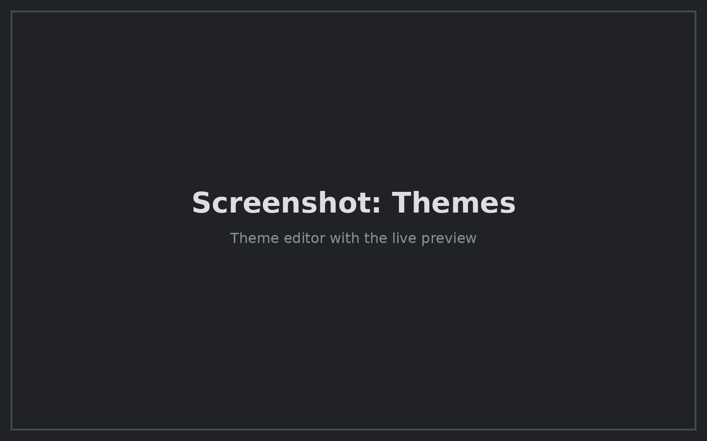

<div align="center">


# Bonsai

A desktop client for Roblox that runs all your accounts at once.

**[Download](https://github.com/6E6B/bonsai/releases)** · Windows, macOS, Linux

</div>



Bonsai does what the Roblox website does, in a native app built for speed and the keyboard.
Every account you add stays signed in, and you can switch between them instantly.

## Why use it

**All your accounts, side by side.** Switch with `Ctrl+1`–`Ctrl+9`. Join a game, buy an item or
add a friend as another account without switching. Item, community and inventory pages show
which of your accounts own the item, belong to the community, or hold a role.

**Everything from the keyboard.** `Ctrl+K` opens a command bar that can do anything the app can:
join a friend, open an item, send a trade, change a setting. Lists use `j`/`k`, and screens have
`g` shortcuts (`g t` for Trades). Press `?` for the full list.



**Better trading.** Every trade shows RAP and value per side, Robux after fee, and net gain.
Bonsai warns you about lopsided trades and projected or on-hold items. You can go through inbound
trades with `a`, `d` and `c`. Item values from Rolimons are optional.



**Things the website doesn't have.** Pick the best or smallest server. Chat drafts survive
restarts. See price history charts, wishlist price drops, a Robux ledger with spending insights,
and CSV export for trades, members and transactions. [Full list](docs/features.md).

**Yours to change.** Build a theme from three colors, or import one someone shared. Add plugins
written in Luau. See [themes](docs/theming.md) and [plugins](docs/plugins.md).



## Is it safe?

Bonsai needs your `.ROBLOSECURITY` cookie, so here is how it's handled:

- The cookie is stored in your OS keychain. It is never saved in plain text, logged, or shown in the UI.
- Only Roblox servers ever receive your cookie. The app's UI can't make network requests at all.
- Bonsai never acts on its own. Purchases, trades, messages and friend requests only happen when you click or press a key.
- Plugins run in a sandbox, can't see your cookie, and need your permission for each account.
- It's open source, so you can check all of this.

## Install

Get the installer for your system from [Releases](https://github.com/6E6B/bonsai/releases):
`.exe` or `.msi` on Windows, `.dmg` on macOS, `.deb`, `.rpm` or `.AppImage` on Linux.

Builds aren't code-signed yet. On Windows, click **More info → Run anyway**. On macOS, right-click
the app and choose **Open** the first time.

On Linux, you can launch games through [Sober](https://sober.vinegarhq.org) by setting
the launch command in **Settings → General**.

## Build from source

You need [Rust](https://rustup.rs), [bun](https://bun.sh), and the
[Tauri prerequisites](https://tauri.app/start/prerequisites/) for your OS.

```sh
git clone --recursive https://github.com/6E6B/bonsai
cd bonsai/crates/bonsai/ui
bun install
bun run app
```

To contribute, read [AGENTS.md](AGENTS.md) for how the code is laid out and the rules it follows,
and [docs/gaps.md](docs/gaps.md) for what's left to build.

---

Bonsai is not affiliated with Roblox Corporation. Licensed under [GPL-3.0](LICENSE).
