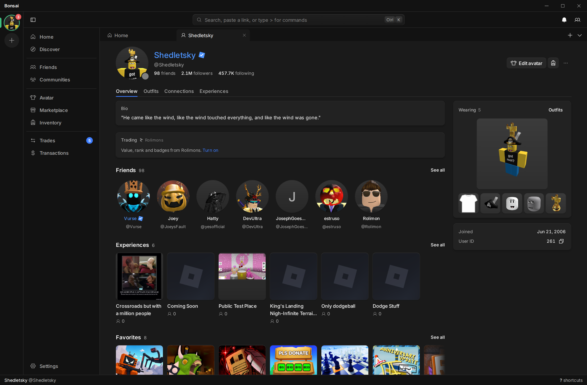
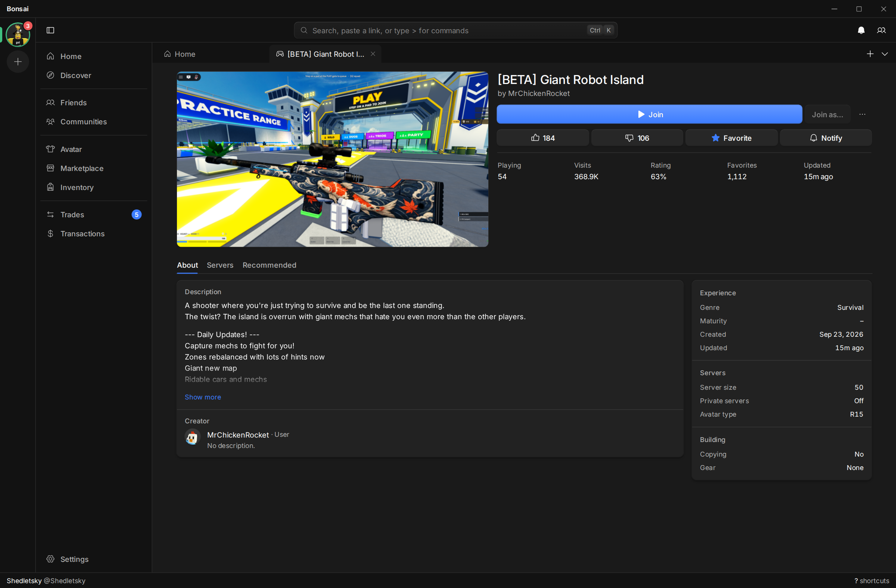

<div align="center">


# Bonsai

**A fast, keyboard-first desktop client for Roblox, built for people with more than one account.**

[](https://github.com/6E6B/bonsai/actions/workflows/rust.yml)
[](https://github.com/6E6B/bonsai/actions/workflows/ui.yml)
[](LICENSE)


[Releases](https://github.com/6E6B/bonsai/releases) · [Features](docs/features.md) · [Install](#install) · [Plugins](docs/plugins.md) · [Building](#building) · [Architecture](AGENTS.md)

</div>


*Demo screenshots use Shedletsky's public profile. Activity and trades are illustrative.*

Bonsai replaces the Roblox website. It does nearly everything the site does: games and servers,
the avatar editor, the Marketplace, inventory, trades, chat and messages, friends, communities,
transactions, and account and security settings. The few things it doesn't do yet are listed in
[docs/gaps.md](docs/gaps.md).

It also keeps several accounts signed in at once, and every action can be run from the keyboard
through a command bar (`Ctrl+K`). [docs/features.md](docs/features.md) lists what it adds beyond the site.

<p>
  
  
</p>

<p>
  
  
</p>

Themes and plugins are covered in [docs/theming.md](docs/theming.md) and [docs/plugins.md](docs/plugins.md).

## Security

- `.ROBLOSECURITY` cookies are stored in the OS keychain. They are not saved in plain text, logged, or sent to the UI.
- Network requests are made only by the Rust backend. Cookies are sent only to Roblox.
- Bonsai makes no purchases, trades, messages or friend requests on its own. Every write comes from a click or keypress.
- Plugins can't read cookies and need permission per account.

## Install

Installers are on the [Releases](https://github.com/6E6B/bonsai/releases) page: `.exe` and `.msi`
for Windows, `.dmg` for macOS, and `.deb`, `.rpm` and `.AppImage` for Linux.

Builds are not code-signed. On Windows, SmartScreen asks for confirmation (More info → Run anyway).
On macOS, right-click the app and choose Open the first time.

To launch games through [Sober](https://sober.vinegarhq.org) on Linux, set the launch command in Settings → General.

## Building

Requires [Rust](https://rustup.rs), [bun](https://bun.sh) and the
[Tauri prerequisites](https://tauri.app/start/prerequisites/) for your OS.

```sh
git clone --recursive https://github.com/6E6B/bonsai
cd bonsai/crates/bonsai/ui
bun install
bun run app
```

See [AGENTS.md](AGENTS.md) for the code layout and contribution rules.

## License

[GPL-3.0](LICENSE). Not affiliated with Roblox Corporation.
